  

 

こんにちは、劉卓文です。**北陸先端科学技術大学院大学（JAIST）先端科学技術専攻・サイバーセキュリティ研究室**の修士 2 年に在籍しています。

研究テーマは **SOC（セキュリティ運用）におけるエージェントのセキュリティ**で、LLM エージェントを実際のセキュリティ運用の現場に安全かつ確実に導入できるようにすることを目指しています。また、**中国の無形文化遺産の保護**にも取り組んでおり、最先端の AI 技術を活かして、伝統文化のデジタルな保存と継承を支えることに力を入れています。

## 🔬 Research

<b>各プロジェクトの概要</b>

- **プレプリント・小型 LLM 分析エージェントに偽造ログを疑わせる学習は可能か**（筆頭著者、DOI 10.5281/zenodo.23311714）：22 のモデル構成（0.5B〜72B）で 1.1 万エピソードの偽造ログ・レッドチーム評価を実施。結論を出せる 4B〜72B のモデルはいずれも 36 件中 30〜36 件の攻撃を見逃し、その多くは矛盾する本物の記録をすでに確認していました。LoRA SFT + GRPO による微調整で、ホールドアウトの見逃しを 58/144 から 7/144 に削減。追加実験中です。
- **[HESP](https://github.com/lzwhehe/HESP)**（筆頭著者、arXiv:2609.33446）：「何を調べるか」と「いつ止めるか」をコントローラが担い、モデルは提案のみを行います。カウントした尤度表で Qwen2.5-7B の検証済み完了率を 0.125 から 1.000 に、コントローラ側の停止で Llama-3.1-8B を 0 から 0.917 に改善しました（事前登録研究 4 件、監査済み 7,272 エピソード）。
- **[Passing the Test You Trained On](https://github.com/lzwhehe/benign-instruction-bench)**（単著、arXiv:2610.03448）：AgentDojo / τ-bench の実際のツール出力を再生し、15 種のプロンプトインジェクション検知器と 2 種の LLM 判定器を再評価。BIPIA 首位の検知器は誤検知率 1% で AgentDojo の注入を約 2% しか検出できず、その学習データに BIPIA の入力 1,116 件が含まれていることも判明しました。
- **[庫淑蘭の彩貼り切り紙の生成](https://github.com/lzwhehe/kushulan-papercut-blora)**（共同筆頭著者、*npj Heritage Science* 査読中）：作品から色紙パレットと切り線を自動復元し、Qwen-Image-Edit をファインチューニング。線再現率 0.97。

## 🧰 Skills

  &nbsp;&nbsp;    

  &nbsp;&nbsp;    

  &nbsp;&nbsp;     

  &nbsp;&nbsp;   

